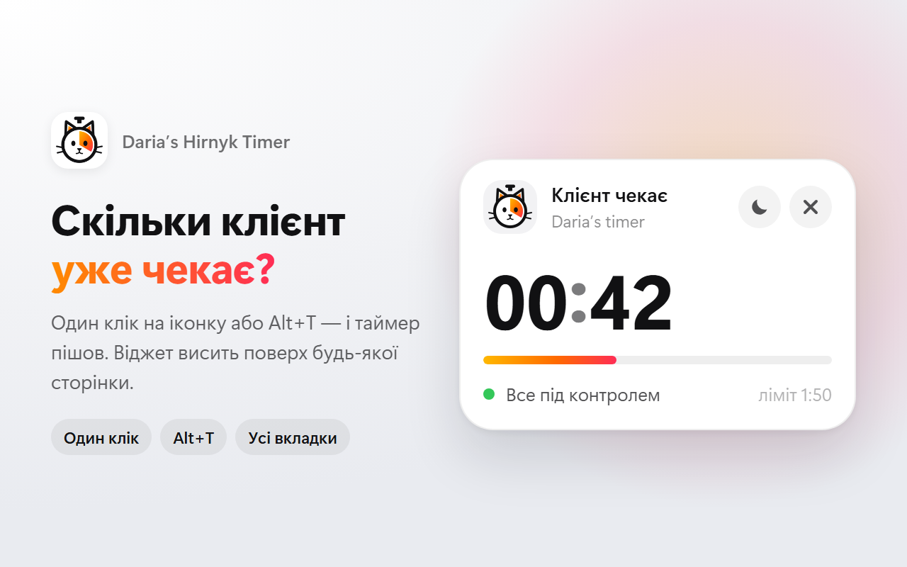

# Daria’s Hirnyk Timer

Розширення для Google Chrome, яке показує, скільки клієнт уже чекає на відповідь.



## Можливості

- **Старт в один клік** — іконка розширення або `Alt+T`. Повторний клік скидає таймер і починає з нуля.
- **Віджет поверх сторінки** з великими цифрами, смужкою прогресу та статусом.
- **Час на іконці** розширення (бейдж), колір змінюється разом зі статусом.
- **Сповіщення** на 1:20 і 1:50.
- **Кольори статусу**: зелений → помаранчевий (з 1:20) → червоний (з 1:50).
- **Світла й темна тема** з перемикачем у віджеті.
- **Перетягування** віджета за шапку, позиція запам'ятовується.
- **Спільний таймер** для всіх вкладок.
- Хрестик закриває віджет і скидає таймер.

## Встановлення для розробки

1. Відкрийте `chrome://extensions`.
2. Увімкніть **Режим розробника**.
3. Натисніть **Завантажити розпаковане розширення** й виберіть папку проєкту.
4. Відкрийте будь-який сайт (на сторінках `chrome://` і в Chrome Web Store віджет не працює).

Після змін у коді натисніть **Оновити** на картці розширення в `chrome://extensions`.

Якщо `Alt+T` не спрацьовує, перевірте призначення в `chrome://extensions/shortcuts`.

## Налаштування

Пороги часу задаються у двох місцях:

| Файл | Що змінити |
|---|---|
| `background.js` | масив `ALERTS` — час і тексти сповіщень; від нього ж залежать кольори бейджа |
| `content/content.js` | `WARN_SEC` і `ALERT_SEC` — кольори віджета й ліміт на смужці прогресу |

Значення в секундах. Тримайте їх однаковими в обох файлах.

## Структура

```
manifest.json         опис розширення (Manifest V3)
background.js         старт/скидання таймера, бейдж, сповіщення
content/content.js    віджет на сторінці (Shadow DOM)
icons/                іконки 16, 48, 128 px
scripts/build.ps1     збірка ZIP для Chrome Web Store
store/                скриншоти, промо-плитка, SVG іконки, тексти для магазину
```

## Збірка для Chrome Web Store

```powershell
powershell -ExecutionPolicy Bypass -File .\scripts\build.ps1
```

Архів з'явиться в `dist/daria-timer-<version>.zip`. Перед кожною публікацією оновлення збільшуйте `version` у `manifest.json`.

Тексти для картки магазину та вкладки Privacy — у [store/listing.md](store/listing.md).

## Конфіденційність

Розширення не збирає й нікуди не передає дані. У `chrome.storage.local` зберігаються лише час старту, видимість віджета, тема та позиція віджета.

## Ліцензія

[MIT](LICENSE)

## Застереження

Це неофіційний особистий проєкт. Він не пов'язаний з monobank чи АТ «Універсал Банк» і не схвалений ними. Проєкт не використовує їхніх логотипів, фірмового стилю чи інших торгових марок.
